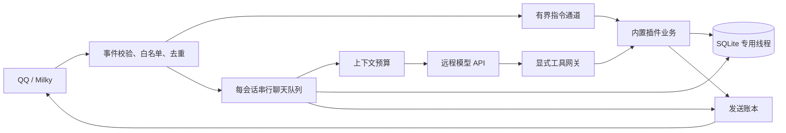

# 实现边界与维护说明

这是面向小规模群聊的 Rust 实现：一个进程、TOML 配置、SQLite，远程调用聊天模型。QQ 客户端及 Milky 服务独立运行。进程不加载本地大模型、分词模型或向量服务。

设计优先级是功能完整、可靠性、资源效率。没有固定 RSS 验收门槛；不为降低测量数字移除功能、证据校验、事务或发送账本。保持默认配置轻量，业务容量可按需要提高；队列、超时、权限与幂等约束继续保护运行可靠性。

## 模块与扩展

| 模块 | 职责 |
| --- | --- |
| `host.rs` | 接收路由、权限入口、公共发送、发送账本、维护任务 |
| `milky.rs` / `llm.rs` | 协议转换、响应大小限制、超时和取消；不执行业务工具 |
| `plugin.rs` / `plugins/mod.rs` | 静态注册、重名与依赖检查、内置插件装配 |
| `tools.rs` | 参数准备、身份绑定、确认、幂等账本和事务执行 |
| `plugins/ai/chat.rs` | 队列、上下文读取、有限的模型与工具循环 |
| `plugins/ai/memory.rs` | 关键词索引、事实证据、摘要提交、遗忘、预算裁剪 |
| `store.rs` | SQLite 线程与有界队列、按插件登记的迁移 |

插件是可信的本地 Rust 源码，随程序编译。当前内置 AI、时钟和可选提醒；`Plugin` 接口提供指令、可选消息观察、初始化和停止回调，注册表处理命令分派。初始化按依赖顺序执行，停止采用反向顺序。增加插件需要实现接口并加入静态装配。没有动态库加载、脚本运行时、自动插件发现或热替换，也不将插件视为安全隔离边界。

模型工具通过独立的 `Tool` 接口注册：声明名称、版本、参数结构和副作用；`prepare` 严格检查并固定参数；`preview` 生成确认说明；`apply` 只在给定事务内执行短小的本地业务，不做网络等待。新增工具不用改 AI 循环。工具目前仅有读取和本地写入两种副作用。

宿主白名单之外，插件可用 `accepts` 收窄指令和事件范围，工具可用 `permits` 收窄操作者及聊天范围；需要限制两种入口时必须分别设置。工具权限会在列出、直接调用、模型调用、确认和提交前复核。消息观察是显式选择加入的有界回调，不能在其中执行长期阻塞工作。

AI 可以在配置中关闭，时钟和提醒仍可独立运行。工具和普通指令调用同一业务实现；不会让模型构造聊天指令来间接获得权限。网络客户端复用连接，但模型认证信息按请求设置。

## 会话与上下文

- 消息身份包含机器人账号、聊天类型、群或好友 ID、消息序号。真正的 `@` 来自 Milky 消息段；文本模仿 `@` 不算提及。
- 群共享模式按群隔离，个人模式按群和用户隔离，好友对话独立隔离。**群里的个人模式仍然在群内公开回复，不是私聊。** 切换模式不迁移另一模式的长期记忆。
- 配置中的默认模式只用于群首次接入；已有群通过 `/ai mode` 切换，并创建新的会话版本，避免修改全局默认值意外恢复旧上下文。
- 入队保存消息位置和会话版本；轮到执行时再读上下文。机器人回复绑定触发它的消息位置，因此排队中的下一条消息可以看到前一轮已确认发送的回答，又不会读到自己之后到达的用户消息。
- `/ai new` 清空当前短期上下文和摘要，保留长期记忆。人设、预算、历史长度、读写记忆和摘要开关都可按会话调整。修改设置取消旧任务。
- `/ai`、`/bot` 内置控制操作在入口按顺序提交，再接收下一条消息；回执异步发送。普通插件命令仍按插件并发额度与超时执行。
- 引用最多展开一层；不可访问或已遗忘的引用有明确标记。命令回执及普通插件消息不作为 AI 回答加入学习材料。

预算统计采用序列化 JSON 的 UTF-8 字节数加预留量，属于保守估算，**不是模型 tokenizer 的精确 token 数**。系统说明、当前问题、工具定义及当前轮完整工具协议计入预算。超额时依次删除低相关记忆、最早历史单元、旧摘要；仍超额就拒绝该请求，不截断当前问题，也不拆开当前轮的工具调用和结果。实际 API 用量另行记账；统计失败会记录警告，但不丢弃已经得到的回答或触发重复请求。

## 记忆与遗忘

近期消息和滚动摘要构成短期记忆。长期记忆是有用户归属的偏好、事实、任务或事件，每条保留原文证据片段。检索只返回当前用户在当前会话中的记忆，默认最多 5 条、1,000 估算 token；可配置 `memory_recall_limit` 和 `memory_recall_budget`，最终服从会话总输入预算。不会跨私聊、群或个人会话搜索。

SQLite FTS5 索引中文单字与双字组合、其他文字的词项；查询优先使用双字组合，按相关性排序，补充当前用户的偏好和任务。不依赖向量库，换一种完全不相似的说法可能漏召回。后续有真实漏召回案例，再评估增加嵌入检索。

后台整理在空闲时冻结旧前缀，一次请求生成摘要和候选事实。前缀按触发消息位置分组，包含对应的晚到机器人回复；裁剪时保留完整组。已有摘要、消息快照、允许修改的记忆 ID 与版本一起校验，全部候选通过后才在同一事务中写入。前台重新活跃或会话版本改变时丢弃过时结果。

摘要覆盖进度与事实处理进度分开保存。`summary off` 停止生成和注入摘要，近期上下文按设置读取原始消息；事实学习可继续推进。再次开启摘要只补齐尚存原文的摘要进度，不重复学习已经处理的事实；关闭摘要期间保留旧摘要，原文到期后无法完整补回。后台整理采用当前会话的历史长度，保留完整最近轮次；生成新摘要时保留完整旧摘要，预算不足则明确推迟，不先静默截断。消息 JSON 嵌入提示内容产生的二次转义同样计入预算。

自动事实需要逐项满足：来源在本次冻结前缀内、原始人类发言允许学习、用户归属相同、证据是连续原文、类型和长度合规、修改对象在允许列表。机器人发言和不允许学习的群背景消息可以参与对话摘要，但不能作为长期事实证据。来源匹配只能证明出处，不能证明模型归纳一定正确；因此模型提示要求只保留明确自述，不推断玩笑或转述。

自动写入关闭时可以继续生成摘要，显式 `remember` 也仍可使用。每会话长期记忆容量由 `max_memories_per_conversation` 配置，默认 256 条；它是磁盘存储配额，降低配额不会删除既有内容。`/ai memory list [页码]` 分页查看本人记忆，后台整理与单次召回始终按需读取。正文最多 180 字符，单次自动变更最多 8 项，TTL 为 1–365 天或不设置。过期项会清理索引及证据记录。更新事实在 SQLite 中保留历史来源键，支持完整撤销；历史来源不随事实更新无限注入模型，只读取当前有界证据。

容量满时，手动新增返回明确错误；自动整理仍先验证全部证据，跳过超出配额的新事实并记录警告，允许合法的已有事实更新和摘要继续提交。不通过删除旧事实腾位置，也不让容量配额阻断摘要维护。

群背景读取和全群事实学习是独立开关。仅开启学习时，背景消息以 `memory_only` 来源保存，禁止进入近期上下文，整理输入标注 `context_visible=false`，要求模型只用于事实提取、不写进摘要。这个摘要约束依赖模型遵守提示，不能像来源和用户归属那样完全用结构校验证明；需要彻底排除群背景内容时，应同时关闭背景读取和全群学习。

`forget ID` 删除记忆和索引，撤销包括旧版本在内的来源消息，将完整消息键保留在撤销表中，并递增会话版本、清空摘要和当前回放上下文。共用这些来源的派生记忆也删除；旧引用及旧整理任务不能恢复它们。它不删除远端模型服务已有的数据，也不阻止用户以后用新消息重新明确说明同一件事。

自动整理中的批量遗忘先冻结全部目标及来源，再统一撤销，避免多个目标共用来源时漏掉历史证据。同批新增按遗忘后的容量判断；因来源撤销而删除的旧事实不会被同批更新恢复。

## 工具与可靠性

第一版仅暴露时钟、提醒列表、创建提醒和取消提醒。模型只能请求已注册并获准的工具；操作者、目标聊天、插件版本、会话版本和收信时间由宿主绑定，不从模型参数读取。没有任意命令、任意 SQL 或任意 Milky API 工具。

模型发起的提醒写入默认必须确认。确认预览由代码生成，令牌绑定原操作者与原聊天，5 分钟有效；等待期间结束模型循环并释放会话执行位置。确认时执行已固定的参数并复核权限。相对时间锚定最初收信时刻，因此等待确认不会把提醒时间不断后移。已创建提醒独立于聊天清空而存在并可跨重启保留，未确认请求在重启后失效。工具网关绑定本次启动的插件代次，旧网关不能借用新实例的权限。

本地业务写入、确认消费、操作结果在同一 SQLite 事务内提交。幂等操作 ID 与模型协议中的 `tool_call_id` 分开，相同轮次的重复请求不会重复创建提醒。工具文本不能自行声称操作成功，结果及业务 ID 由代码回执提供。

工具 `apply` 异常或结果超限时回滚保存点中的业务写入，单独持久化失败回执；结构化结果和文字回执都检查长度。数据库回调发生可展开的 panic 时，事务随栈展开回滚，专用线程继续服务；进程中止、内存耗尽和可信插件的任意非事务写入不受此保护。

网络发送先记意图再提交 Milky。确定失败与结果未知分别保存，结果未知不会盲目重发。已提交的外部请求无法靠取消信号撤回；账本必须记录真实结果。暂停、重置、遗忘通过版本检查抑制过时任务继续写入或发送。

运行实例固定绑定首次核对的机器人账号。离线、异账号事件或事件连接断开使验证状态失效，禁止新发送及引用读取；只有原账号重新登录验证成功才恢复。引用响应必须与发起时处于同一验证代次，即使离线后已重新登录，旧引用请求也不会恢复有效。未提交 HTTP 的提醒恢复为待发送，已经提交的发送保留真实回执或未知状态，不按临时离线推断失败。

## 资源与运维

默认全局待处理聊天 32 条、单会话 4 条、远程模型请求并发 2、后台整理并发 1。每轮默认最多 3 次模型请求、2 次串行工具执行，模型每次最多请求一个工具；保留最终无工具回答的机会。调用次数、HTTP 尝试额度及整轮超时可以按任务提高，仍按各自配置共同限制执行；提高工具次数时也需给模型调用次数留下最终回答额度。当前不自动重试模型请求。完整轮次默认 120 秒、模型请求 60 秒、工具调用 15 秒，数据库和网络响应同样有边界。这些保护不以某个内存数字为依据。

已从会话队列取出、但尚在等待全局执行容量的任务仍计入待处理额度，避免并发等待绕过单会话队列上限。

Tokio 使用单线程运行时，SQLite 在一个专用线程内执行。事务与锁不跨网络等待；同步插件代码仍须自行保持短小，异步超时不能抢占阻塞代码。内存占用还受会话数、输入长度、响应上限和依赖影响，必须用实际发布构建测量；QQ 客户端和 Milky 的占用单独统计。

SQLite 开启 WAL，运行时通常有主文件、`-wal`、`-shm`，不能只复制正在写入的主文件当作备份。使用 SQLite 在线备份或停机后备份。迁移按插件、版本和校验和登记。默认保留原始消息与可清理日志 7 天；未决发送和撤销来源记录有不同保留规则。

已有数据库启动时自动执行 `ai_memory` 版本 2 迁移，将原整理进度初始化为事实处理进度，保留已有摘要、记忆及版本 1 迁移校验和。

配置文件控制插件启停和接入端点，修改后重启；当前不提供 Web 管理页、热重载、多模态、联网搜索或主动聊天。真实环境仍需配置 Milky、模型 API 和白名单后做小群试运行。
