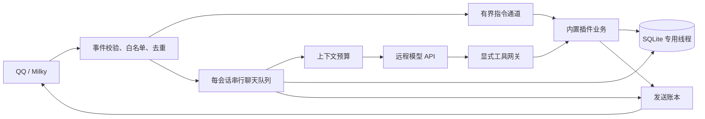

# 实现边界与维护说明

这是面向小规模群聊的 Rust 实现：一个进程、TOML 配置、SQLite，远程调用聊天模型。QQ 客户端及 Milky 服务独立运行。进程不加载本地大模型、分词模型或向量服务。

设计优先级是功能完整、可靠性、资源效率。没有固定 RSS 验收门槛；不为降低测量数字移除功能、证据校验、事务或发送账本。保持默认配置轻量，业务容量可按需要提高；队列、超时、权限与幂等约束继续保护运行可靠性。

## 模块与扩展

| 模块 | 职责 |
| --- | --- |
| `host.rs` | 接收路由、权限入口、公共发送、发送账本、维护任务 |
| `milky.rs` / `llm.rs` | 协议转换、响应大小限制、超时和取消；不执行业务工具 |
| `plugin.rs` / `plugins/mod.rs` | 静态注册、重名与依赖检查、内置插件装配 |
| `tools.rs` | 参数准备、身份绑定、确认、幂等账本和事务执行 |
| `plugins/ai/chat.rs` | 队列、上下文读取、有限的模型与工具循环 |
| `plugins/ai/memory.rs` | 关键词索引、事实证据、摘要提交、遗忘、预算裁剪 |
| `store.rs` | SQLite 线程与有界队列、按插件登记的迁移 |
| `admin/` | 密码与会话认证、配置缓存及原子保存、会话与记忆管理、机器人启停和 LLBot 扫码适配 |

插件是可信的本地 Rust 源码，随程序编译。当前内置 AI、时钟和可选提醒；`Plugin` 接口提供指令、可选消息观察、初始化和停止回调，注册表处理命令分派。初始化按依赖顺序执行，停止采用反向顺序。增加插件需要实现接口并加入静态装配。没有动态库加载、脚本运行时、自动插件发现或热替换，也不将插件视为安全隔离边界。

模型工具通过独立的 `Tool` 接口注册：声明名称、版本、参数结构和副作用；`prepare` 严格检查并固定参数；`preview` 生成确认说明；`apply` 只在给定事务内执行短小的本地业务，不做网络等待。`NetworkRead` 工具额外实现 `ExternalTool`，由网关在预占额度后于事务外异步执行，并在结束及回复提交前复核授权。表情检索与最终回复另有专用协议。联网搜索的配置和运行边界见 [联网搜索](web-search.md)。

宿主白名单之外，插件可用 `accepts` 收窄指令和事件范围，工具可用 `permits` 收窄操作者及聊天范围；需要限制两种入口时必须分别设置。工具权限会在列出、直接调用、模型调用、确认和提交前复核。消息观察是显式选择加入的有界回调，不能在其中执行长期阻塞工作。

AI 可以在配置中关闭，时钟和提醒仍可独立运行。工具和普通指令调用同一业务实现；不会让模型构造聊天指令来间接获得权限。网络客户端复用连接，但模型认证信息按请求设置。

## 会话与上下文

- 消息身份包含机器人账号、聊天类型、群或好友 ID、消息序号。真正的 `@` 来自 Milky 消息段；文本模仿 `@` 不算提及。
- 群共享模式的短期上下文按群隔离，个人模式按群和用户隔离，好友对话独立隔离。**群里的个人模式仍然在群内公开回复，不是私聊。** 长期记忆默认按同一机器人账号和用户 QQ 跨会话共享；关闭全域共享时才按来源会话隔离，切换群模式不迁移记录。
- 配置中的默认模式只用于群首次接入；已有群在 Web 会话管理中切换，并创建新的会话版本，避免修改全局默认值意外恢复旧上下文。
- 入队保存消息位置和会话版本；轮到执行时再读上下文。机器人回复绑定触发它的消息位置，因此排队中的下一条消息可以看到前一轮已确认发送的回答，又不会读到自己之后到达的用户消息。
- Web 重置清空当前短期上下文和摘要，保留长期记忆。人设、预算、历史长度、读写记忆和摘要开关都可按会话调整。设置写入有版本检查，修改设置使旧任务失效。
- 聊天保留 `/clock`、`/remind` 业务指令和 `/bot confirm`、`/bot reject` 本人确认。普通插件命令按插件并发额度与超时执行；管理操作统一由 Web 的可信管理员会话进入。
- 引用最多展开一层；不可访问或已遗忘的引用有明确标记。命令回执及普通插件消息不作为 AI 回答加入学习材料。

预算统计采用序列化 JSON 的 UTF-8 字节数加预留量，属于保守估算，**不是模型 tokenizer 的精确 token 数**。系统说明、当前问题、工具定义及当前轮完整工具协议计入预算。超额时依次删除低相关记忆、最早历史单元、旧摘要；仍超额就拒绝该请求，不截断当前问题，也不拆开当前轮的工具调用和结果。实际 API 用量另行记账；统计失败会记录警告，但不丢弃已经得到的回答或触发重复请求。

## 记忆与遗忘

近期消息和滚动摘要构成短期记忆。长期记忆是有用户归属的偏好、事实、任务或事件，每条保留来源会话和原文证据片段。`plugins.ai.global_memory_shared` 默认开启：按机器人账号和用户 QQ 检索该用户在所有群聊、私聊与群内个人模式中的记忆，不能串用其他用户或其他机器人账号的记录。关闭后仅检索当前来源会话；切换不复制、移动或删除记录，已有记录同样参与共享。近期消息、摘要和会话设置始终保持原有隔离。每次默认最多返回 5 条、1,000 估算 token；可配置 `memory_recall_limit` 和 `memory_recall_budget`，最终服从会话总输入预算。

应用全域共享开关变更会重新计算长期记忆范围，增加会话版本并重置活跃短期上下文、摘要和整理游标，使旧任务失效，避免关闭后残留已共享内容。长期记忆、来源证据和原始消息保留；原始消息仍按保留期清理。

迁移 v4 为会话增加独立的 `memory_scope`，记忆的 `conversation_id` 继续保存原始来源。共享域内的记忆写入通过数据库触发器推进所有相关会话的记忆版本，阻止并发整理覆盖旧快照；目前采用整个机器人共享域的版本校验，不同用户的并发写入也可能让整理重试。遗忘会保守重置同一机器人所有会话的短期上下文，使已读取旧记忆的任务失效。

SQLite FTS5 索引中文单字与双字组合、其他文字的词项；查询优先使用双字组合，按相关性排序，补充当前用户的偏好和任务。不依赖向量库，换一种完全不相似的说法可能漏召回。后续有真实漏召回案例，再评估增加嵌入检索。

后台整理在空闲时冻结旧前缀，一次请求生成摘要和候选事实。前缀按触发消息位置分组，包含对应的晚到机器人回复；裁剪时保留完整组。已有摘要、消息快照、允许修改的记忆 ID 与版本一起校验，全部候选通过后才在同一事务中写入。前台重新活跃或会话版本改变时丢弃过时结果。

摘要覆盖进度与事实处理进度分开保存。关闭摘要会停止生成和注入摘要，近期上下文按设置读取原始消息；事实学习可继续推进。再次开启摘要只补齐尚存原文的摘要进度，不重复学习已经处理的事实；关闭摘要期间保留旧摘要，原文到期后无法完整补回。后台整理采用当前会话的历史长度，保留完整最近轮次；生成新摘要时保留完整旧摘要，预算不足则明确推迟，不先静默截断。消息 JSON 嵌入提示内容产生的二次转义同样计入预算。

后台提炼和摘要整理使用独立的 `memory_input_budget`，默认 8000 估算 token，为完整提炼规则、原文证据与可修改记忆留出空间；输出预算 `memory_output_budget` 默认 3200。普通聊天的 `plugins.ai.defaults.input_budget` 仍默认 6000，不受后台预算调整影响。

自动记忆采用日常记录口径：明确表达的饮食、娱乐、近况、心情、活动经历、项目小进展和计划，一次提及即可提取，不要求长期稳定或特别重要。临时状态建议保留 7–30 天，普通事件 30–90 天，重要经历和稳定偏好可长期保存；这是模型提取策略，实际 TTL 仍由候选记录给出。事件保留时间与计划、完成、取消等状态，一次经历或评价不能推成长期偏好。

自动记忆需要逐项满足：来源在本次冻结前缀内、原始人类发言允许学习、用户归属相同、证据是连续原文、类型和长度合规、修改对象在允许列表。机器人发言和不允许学习的群背景消息可以参与对话摘要，但不能作为长期事实证据。来源匹配只能证明出处，不能证明模型归纳一定正确；模型仍排除传闻、玩笑、问候和未经表达的推断。新口径适用于之后的整理，不自动回溯已处理的历史消息，也不重置现有记忆或人设。

自动写入关闭时可以继续生成摘要，Web 人工维护也仍可使用。长期记忆容量由 `max_memories_per_conversation` 配置，默认 256 条：全域共享时按同一机器人账号内每个 QQ 用户计，关闭时按来源会话计。它是磁盘存储配额，降低配额不会删除既有内容。Web 显示当前共享范围和记录来源，支持按用户、关键词及启用状态分页查看记忆，详情和关联原文按需读取。正文最多 180 字符，单次自动变更最多 16 项，后台输出预算默认 3200，TTL 为 1–365 天或不设置。过期或停用记录只排除召回，保留记录和证据，继续计入存储容量。更新事实在 SQLite 中保留历史来源键，支持完整撤销；历史来源不随事实更新无限注入模型，只读取当前有界证据。

人工新增和编辑的记录标为 `manual` 并默认锁定；人工新增不伪造 QQ 消息来源，编辑保留的历史来源标明属于原记录。自动整理只允许新增或修改当前冻结批次中归属相同、启用且未锁定的 `auto` 记录，不能改动人工或其他来源记录，也不能提出永久遗忘。管理员可手动启用、停用、编辑或调整锁定状态。

容量满时，手动新增返回明确错误；自动整理仍先验证全部证据，跳过超出配额的新事实并记录警告，允许合法的已有事实更新和摘要继续提交。不通过删除旧事实腾位置，也不让容量配额阻断摘要维护。

群背景读取和全群事实学习是独立开关。仅开启学习时，背景消息以 `memory_only` 来源保存，禁止进入近期上下文，整理输入标注 `context_visible=false`，要求模型只用于事实提取、不写进摘要。这个摘要约束依赖模型遵守提示，不能像来源和用户归属那样完全用结构校验证明；需要彻底排除群背景内容时，应同时关闭背景读取和全群学习。

Web 永久遗忘先预览影响范围，再显式确认，可一次选择 1–1000 条记录。确认绑定管理员会话、目标版本、会话版本和五分钟期限；执行前重新校验。确认后删除记忆和索引，撤销包括旧版本在内的来源消息，将完整消息键保留在撤销表中，并递增受影响会话版本、清空摘要和当前回放上下文。共用这些来源的派生记忆也删除，预览会显示范围；旧引用及旧整理任务不能恢复它们。它不删除远端模型服务已有的数据，也不阻止用户以后用新消息重新明确说明同一件事。

管理写入使用请求 ID 幂等执行并提供结果查询，审计只保存操作 ID、目标和数量，不复制记忆正文。停用和过期不会自动释放容量；需要永久删除时由管理员确认遗忘。

## 全局学习笔记

`ai::learning` 保存按机器人账号划分的经验条目及其历史版本，独立于 QQ 个人记忆、会话摘要和它们的处理游标。默认关闭；启用边界记录消息水位，只读取之后的有效群聊学习来源。批次按群轮转，冻结笔记版本、来源、会话边界与权限；无工具的后台模型提出有证据的变更，事务重新校验后才提交，冲突不覆盖新版本。管理员锁定、总字符容量及每批变更上限均由宿主执行。

`RequestAdmission::Learning` 使用独立的小时和滚动 24 小时请求池，HTTP 前持久预占，失败和不确定请求同样消耗额度。保留 24 小时准入记录后，普通聊天与记忆整理的统计仍显式按小时筛选。学习复用空闲后台请求槽，不排队抢占聊天。读取笔记作为资料使用独立输入额度（默认 12,000，管理员可调），在普通上下文完成预算组装后添加，按 JSON 消息字节加分隔符精确计入保守估算，总估算不超过普通输入预算与笔记额度之和。版本与来源依赖经过模型排队后、模型返回后、工具准入及 outbox 最终提交检查。

修改条目保留历史来源依赖。撤回及个人记忆遗忘同一事务失效相关学习笔记与历史，阻止旧版本回滚和旧模型结果重新引入已撤销内容；同时清除该账号短期上下文，防止已生成摘要继续传播被遗忘内容。私聊既不作为学习来源，也不直接注入全局学习笔记。

## 工具与可靠性

第一版仅暴露时钟、提醒列表、创建提醒和取消提醒。模型只能请求已注册并获准的工具；操作者、目标聊天、插件版本、会话版本和收信时间由宿主绑定，不从模型参数读取。没有任意命令、任意 SQL 或任意 Milky API 工具。

本地写工具通过 `Tool::requires_confirmation` 声明是否需要本人确认，默认要求确认。提醒创建和取消读取 `[plugins.reminder].llm_writes_require_confirmation`，新配置默认 `false`，按用户请求直接执行；显式 `true` 继续使用确认预览。两种模式共用身份、会话、权限、插件代次和幂等校验，模型不能指定其他操作者或聊天。确认令牌绑定原操作者与原聊天，5 分钟有效；等待期间结束模型循环并释放会话执行位置，确认时执行已固定参数并复核权限。相对时间锚定最初收信时刻。已创建提醒独立于聊天清空而存在并可跨重启保留，未确认请求在重启后失效；旧网关不能借用新实例权限。

本地业务写入、确认消费、操作结果在同一 SQLite 事务内提交。幂等操作 ID 与模型协议中的 `tool_call_id` 分开，相同轮次的重复请求不会重复创建提醒。工具文本不能自行声称操作成功，结果及业务 ID 由代码回执提供。

工具 `apply` 异常或结果超限时回滚保存点中的业务写入，单独持久化失败回执；结构化结果和文字回执都检查长度。数据库回调发生可展开的 panic 时，事务随栈展开回滚，专用线程继续服务；进程中止、内存耗尽和可信插件的任意非事务写入不受此保护。

网络发送先记意图再提交 Milky。确定失败与结果未知分别保存，结果未知不会盲目重发。已提交的外部请求无法靠取消信号撤回；账本必须记录真实结果。暂停、重置、遗忘通过版本检查抑制过时任务继续写入或发送。

运行实例固定绑定首次核对的机器人账号。离线、异账号事件或事件连接断开使验证状态失效，禁止新发送及引用读取；只有原账号重新登录验证成功才恢复。引用响应必须与发起时处于同一验证代次，即使离线后已重新登录，旧引用请求也不会恢复有效。未提交 HTTP 的提醒恢复为待发送，已经提交的发送保留真实回执或未知状态，不按临时离线推断失败。

## 资源与运维

默认全局待处理聊天 32 条、单会话 4 条、远程模型请求并发 2、后台整理并发 1。每轮默认最多 3 次模型请求、2 次串行工具执行，模型每次最多请求一个工具；保留最终无工具回答的机会。调用次数、HTTP 尝试额度及整轮超时可以按任务提高，仍按各自配置共同限制执行；提高工具次数时也需给模型调用次数留下最终回答额度。当前不自动重试模型请求。完整轮次默认 120 秒、模型请求 60 秒、工具调用 15 秒，数据库和网络响应同样有边界。这些保护不以某个内存数字为依据。

已从会话队列取出、但尚在等待全局执行容量的任务仍计入待处理额度，避免并发等待绕过单会话队列上限。

Tokio 使用单线程运行时，SQLite 在一个专用线程内执行。事务与锁不跨网络等待；同步插件代码仍须自行保持短小，异步超时不能抢占阻塞代码。内存占用还受会话数、输入长度、响应上限和依赖影响，必须用实际发布构建测量；QQ 客户端和 Milky 的占用单独统计。

SQLite 开启 WAL，运行时通常有主文件、`-wal`、`-shm`，不能只复制正在写入的主文件当作备份。使用 SQLite 在线备份或停机后备份。迁移按插件、版本和校验和登记。默认保留原始消息与可清理日志 7 天；未决发送和撤销来源记录有不同保留规则。

已有数据库按顺序执行迁移：`ai_memory` 版本 2 初始化独立事实进度，版本 3 加入记忆来源、锁定、版本与管理操作记录，并回填旧证据。历史迁移校验和不变，原有内容保留。

配置文件控制插件启停和接入端点，可从管理页面保存并应用。应用时先等待旧机器人正常停机，再启动新实例；已提交发送仍完成账本记录。SQLite 数据服务由进程持有，运行实例共享同一个专用数据库线程；停止机器人或 QQ 尚未登录时，Web 仍可管理数据。只有进程退出才关闭该数据服务，`app.database` 和 `limits.database_queue` 改动需要整进程重启。当前不提供动态插件热加载、多模态、联网搜索或主动聊天。真实环境仍需配置 Milky、模型 API 和白名单后做小群试运行。

## Web 管理边界

Axum HTTP 服务与机器人同进程，HTML/CSS/JavaScript 随二进制嵌入，无 Node 服务或前端构建依赖。默认仅监听 `127.0.0.1:3210`。首次设置密码需要一次性初始化码；认证状态保存在配置文件父目录的 `.qkbot-admin/credentials.json`，不跟随业务数据库路径。密码使用随机盐的 Argon2id（19 MiB、2 次迭代、并行度 1），验证放在阻塞任务中，独立并发为 1，全局每分钟最多 10 次尝试。文件原子保存，密码更换撤销全部旧会话。

服务端最多保存 32 个随机会话；Cookie 使用 `HttpOnly`、`SameSite=Strict`，最长 8 小时、30 分钟无管理交互失效，被动轮询不延长期限。重新验证密码会轮换会话和 CSRF 凭据，保留原绝对有效期。每个写请求检查会话绑定的 CSRF 头，敏感操作要求最近 5 分钟密码验证，首次设置和登录也检查请求来源。`web.secure_cookie` 明确控制 `Secure` Cookie：本机 HTTP 默认 false，公开部署必须使用 HTTPS 并设为 true，不能依靠客户端转发头判断。

拒绝跨来源请求，响应禁止缓存、嵌入和外部脚本。请求体最多 4 MiB，以容纳合法 1 MiB TOML 转换后的完整 JSON；磁盘配置限制仍为 1 MiB。管理请求并发和耗时有界。

`ConfigStore` 缓存已验证的有效配置、文件摘要版本和去除凭据的快照。仅启动、保存和明确刷新配置时读取文件；运行状态和 QQ 轮询只读内存，不重建客户端、不重复解析 TOML。密钥修改采用明确的 keep/set/clear 操作；客户端必须提交完整配置和文件摘要版本。存储层验证结构、插件注册及地址安全，允许模型连接信息暂未填写完整；运行连接验证交给启动和应用阶段，避免用户无法打开管理页修复配置。

保存写入同目录临时文件并同步，重新检查版本后原子替换；缓存与文件提交在同一阻塞任务内完成。程序内保存串行，取消 HTTP 请求不会中断已进入保存线程的提交；失败的外部刷新不会覆盖最后有效缓存。文件编辑器不参与本进程锁，保存前会检测到已发生的外部修改，应避免同时编辑。

管理页区分已保存版本与当前应用版本；保存全局配置不会批量改写已有会话设置。应用配置重建机器人运行实例，插件代次变化会使未确认工具请求失效，已创建提醒和记忆保留。数据库路径和数据库队列容量在进程启动时固定；管理服务启用状态、监听地址、安全 Cookie 开关和日志级别也需要整进程重启。

模型请求在取得并发槽位后、发送 HTTP 前，以 SQLite 事务检查上下文和插件代次并记账。前台按用户、会话及全局计算最近 3600 秒额度，工具续轮也计数；后台整理使用独立额度。默认分别为 60、180、600 和 60 次，均可配置。失败或结果未知的已准入请求保留计数，重启不会清空额度。实际 token 用量独立统计，不将估算预算当作真实账单。

Web 写入提交后仅取消旧代次任务，保留并发到达的新上下文消息；HTTP 断开不打断已提交操作的收尾。进程退出先排空 Web 管理任务，再停止机器人并关闭数据库；关键停机写入等待队列空位，避免短暂繁忙让数据管理永久失效。

扫码模块仅请求 LLBot 的两个固定接口，独立于 Milky 访问令牌。服务端以 LLBot WebUI 密码的 SHA-256 摘要认证，禁止重定向，不把凭据或上游原始错误返回浏览器。状态缓存 3 秒，同时刷新合并为一个上游请求，二维码获取单并发。鉴权错误暂停访问直到明确重试或配置变化；配置错误和暂时故障有不同错误码，页面可据此暂停或退避。QQ 配置拥有独立递增代次，即使改动后恢复原值，在途旧请求也不能污染新状态。缓存客户端和请求前后检查都只读取 `ConfigStore` 快照。

二维码只接收有大小和尺寸边界的 PNG 数据；页面不连接外部二维码生成服务。LLBot 的安装、运行模式和签名授权需先按其官方文档配置，本项目不提供 QQ 登录协议或签名服务实现。
