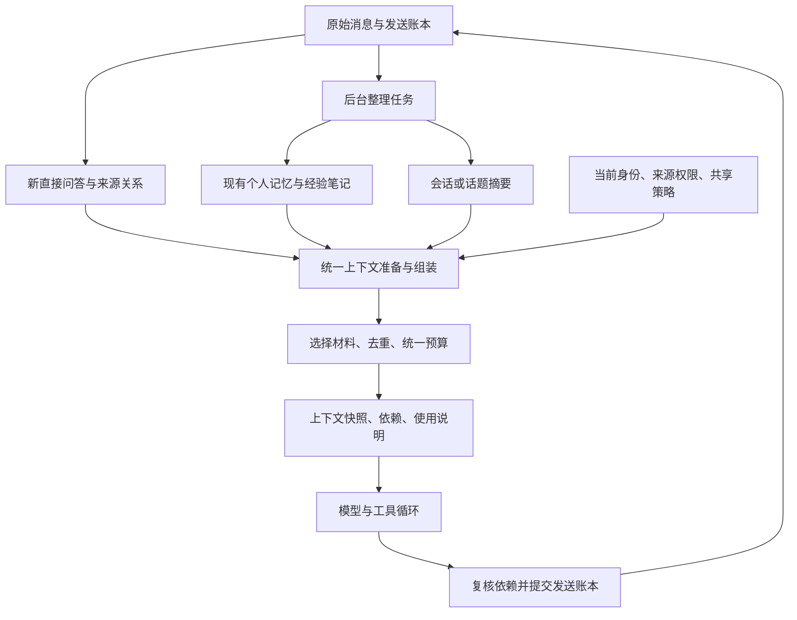

# 统一上下文与记忆：实施现状与后续设计

日期：2026-10-24。状态：本次已实现统一读取、组装与依赖边界、新直接问答元数据、跨群与私聊接续，以及「上下文与知识」管理入口。

首个产品场景是同一 QQ 用户在同一机器人账号的群聊、私聊之间切换后，接续刚才的对话。当前仍保留个人记忆、经验笔记的原有权威表、两套 Embedding 缓存、后台整理任务、配额及已有管理 API；统一知识存储和写入协议属于后续工作。下文分别说明已落地边界与后续设计，不能把目标结构理解为已完成全部存储迁移。

管理页从「上下文与知识 → 对话接续」查看近期问答与已保存的预算设置，点击「调整接续与背景窗口」进入配置；TOML 对应 `[plugins.ai.context]`，修改后需保存并应用。

| 配置 | 当前默认值 | 说明 |
| --- | --- | --- |
| `enabled` | `true` | 开启跨会话近期接续；仍受会话记忆读取与暂停设置约束 |
| `recent_seconds / max_turns` | `7200 / 3` | 最近 2 小时、最多 3 轮候选，不保证全部注入 |
| `neighbors_before / neighbors_after` | `10 / 5` | 每轮来源提问前最多 10 条、后最多 5 条合格群聊消息 |
| `neighbor_seconds` | `120` | 前后各自最多 2 分钟，同时不越过当前请求水位 |
| `recall_budget / neighbor_budget` | `3000 / 1500` | 问答含背景的估算额度，以及其中背景的子上限 |

升级后新登记、已确认发送的直接问答才可作为跨会话核心；旧历史不猜测回填，多人自动接话不归到最后发言人名下，也不按尾消息用户读取跨场景近期对话。辅助邻域同时受条数、时间和预算限制，只读取来源逻辑会话中的合格消息。不同机器人、不同 QQ 的核心问答隔离；群背景中的其他成员仍保留独立身份，来源群权限、会话模式、背景读取开关和撤销状态继续校验。

## 1. 当前问题与设计决定

现有功能已经有证据校验、撤销标记、发送账本和并发保护，重构应保留这些约束。主要问题是职责和规则分散，而不是缺少另一套存储。

| 改造前问题 | 本次处理 | 后续边界 |
| --- | --- | --- |
| 本会话历史、个人记忆与学习笔记分别组装 | `context::prepare` 统一准备知识与接续候选，assembly 统一最终组装 | 本地历史仍通过原有 `load_context` 读取 |
| 普通聊天预算完成后再追加笔记 | 一个最终输入上限，保留旧笔记额度；接续在普通额度内分区 | 不改变各用途模型请求配额 |
| 个人记忆与笔记各有向量缓存和检查 | 统一调用、选择和最终依赖校验 | 两套缓存和类型专属校验保留，索引基础设施尚未合并 |
| 各种 guard 沿工具和发送路径分别传播 | 新增统一 `ContextDependencyGuard`，追踪实际使用资料及其派生回复、摘要 | 工具授权仍由宿主独立执行 |
| 仅长期事实跨会话共享，近期指代没有问答来源 | 新登记的同用户已完成直接问答进入上下文候选 | 自动接话和历史问答回填不在本次范围内 |

上下文是根据当前请求选择材料后形成的视图。原始消息、问答关系和知识条目才是持久化来源；不另建一个不断累加正文的“全局上下文库”。

## 2. 当前结构与后续目标



继续使用 Rust、SQLite 和现有远程模型接口。这个设计不要求外部记忆服务、图数据库或新框架。

### 2.1 原始消息与问答关系

本次保留 `messages`、`outbox` 作为消息与发送状态的权威来源，新增 `ai_context_sources`、`ai_recent_turns` 与依赖关系表，记录直接触发资格及已完成问答：

- 机器人账号、明确触发用户、原始消息键及来源快照。
- 提问消息位置、已确认回复消息键、完成时间及确认事务中的消息水位；确认水位必须早于当前请求，避免 self echo 提前到达时误读迟来的回答。
- 生成该回复曾使用的跨会话资料、知识版本及摘要来源依赖。

完整自动接话参与者、通用触发类型和发送完成序号属于后续元数据扩展。

正文不重复存储。发送确认且原有 guard、插件和访问版本仍有效时，在保存 assistant 消息的同一事务中登记问答。

直接问答可归属于触发用户；多人自动接话不能仅归属最后发言的人。当前实现合并自动接话批次时会更新 `actor` 和 `inbound_position`，旧持久层没有完整触发类型和批次来源，因此不能自动把旧回复全部回填成个人问答。第一版跨场景接续使用新登记的直接问答；自动接话需要明确的参与者与适用范围策略后再加入。

### 2.2 统一知识模型（后续目标）

个人记忆和学习笔记成为同一知识服务中的不同类型。公共模型建议包含：

| 字段 | 含义 |
| --- | --- |
| `id, bot_id, version` | 稳定身份、机器人账号、内容版本 |
| `kind` | `fact / preference / task / event / experience / correction / term` |
| `subject` | 描述的对象：某个用户、群或机器人；不是读取权限 |
| `audience_policy` | 什么请求可以读取，结合当前发言者、目标场景及共享配置判断 |
| `origin` | 自动提炼、管理员维护、兼容导入 |
| `text, payload` | 可读正文，以及按类型验证的状态、时间等可选字段 |
| `active, locked, expires_at` | 启用、禁止自动编辑、到期状态 |
| `created_at, updated_at` | 记录时间；事件发生时间单独保存 |

来源通过独立关联表示，允许一条知识引用多个原始消息或上游条目的特定版本。至少区分：证据作者、消息发生场景、描述对象、适用范围。不能只拿最初的 `conversation_id` 代表整条知识后来所有证据的来源。

类型仍有不同的校验规则：

- 个人事实与偏好保留现有本人证据、归属和允许修改列表规则。
- 机器人回答可作为对话经历和摘要材料，但不能因为被再次读取就成为本人事实证据；自动事实仍要求合格的人类原始发言。
- 经验、纠错、术语保留现有笔记的群范围或 shared 范围；现有 shared 笔记不会因合表而自动开放给私聊。
- 管理员新增可以没有聊天原文，但必须标记为人工记录，不伪造本人证据。
- `locked` 只控制编辑，不自动提高召回优先级，也不赋予系统指令权威。
- 自动产生的知识始终是资料。管理员的人设、行为规则和工具授权继续通过配置入口管理。

本次统一调用现有两种权威表的读取，合并最终预算与依赖检查，尚未实现上表的公共存储模型。后续再迁移公共元数据、版本、来源和索引表，类型校验器继续保留。

### 2.3 摘要与索引

本次摘要正文和进度仍保存在 `ai_conversations`，新增 `ai_context_summary_dependencies` 继承原始消息、旧摘要和所用回复的依赖。个人事实处理、摘要和经验笔记仍使用各自的游标。话题摘要和统一摘要版本模型属于后续设计。

向量和关键词索引继续使用现有实现，模型或内容变化后的失效、权威记录与来源校验保留。后续统一缓存键时，应包含条目身份、内容版本、模型配置命名空间、维度及必要的来源指纹。

原始消息目前默认保留 7 天。摘要只有在所需原文或充分证据仍存在时才能重新生成，不能承诺所有摘要永久可重建；`full / partial / unavailable` 重建状态是后续元数据目标，本次尚未增加。正常保留期清理不等于撤回；长期知识可以继续依赖保存的证据与来源键，永久撤销标记在原消息清理后仍然有效。

## 3. 单一上下文入口

本次入口及返回信息：

```text
ContextRequest
  当前 bot / actor / scope / conversation / epoch
  当前消息、明确引用、触发方式与接收位置
  当前配置与权限版本、预算策略

context::prepare(request) -> PreparedContext
  memories / learning / continuity   有来源和版本的候选

assembly::assemble_with_builder(...) -> AssemblyResult
  context           最终 messages、估算量及本地保留范围
  usage             各分区估算量、候选数和入选数
  selected indices  实际入选的接续与笔记候选

PreparedContext::selected_guard(...)
  ContextDependencyGuard            实际材料依赖
```

当前会话历史、明确引用及摘要的依赖由聊天入口一并加入 guard。更细的淘汰原因和面向管理员的每轮选择轨迹尚未实现。

处理顺序：

1. 冻结当前请求身份、消息水位和配置边界；当前问题、系统规则、工具定义及当前工具协议作为必需输入。
2. 各数据源先按机器人账号、使用范围、启停状态、到期状态和来源资格筛选，再在有限候选内召回。
3. 对命中的近期问答，在允许的来源范围内扩展有限的前后群聊背景，再组装当前会话历史、相关个人记忆、笔记与适用摘要。本次按消息键排除接续片段内重复原文；知识证据邻域扩展、跨摘要语义去重和结构化冲突处理留待后续。
4. 按相关性、时间和完整性选择材料；采用类型预算与统一总上限组装。
5. 冻结实际发送材料的身份和版本，形成依赖集合。在真正提交模型请求前复核，因为向量网络调用和模型排队期间来源可能变化。

同一轮工具循环不动态加入其他场景新到达的问答。每次模型请求可以重新裁剪，但本轮依赖集合应保留“已经发送给模型的全部材料”的并集；后来被裁掉的条目仍可能影响之前生成的回答或工具参数。

### 3.1 跨群、跨私聊接续

同机器人、同 QQ 的已完成问答可以作为跨会话候选。按用户已明确的需求，覆盖群与群、群与私聊两个方向；实际请求还须通过来源和目标的有效访问规则。

当前默认最近 2 小时、最多 3 轮，作为可调范围而非保证全部注入。“继续”“第二个”等缺少关键词的表达也能获得近期完整问答候选，不依赖向量命中。当前问题与完整工具协议优先保留；多个话题无法消歧时仍需模型结合语境处理。

第一版读取语义是：本轮组装上下文时已经完成、且提问位置早于当前消息的问答。在单次数据库读取中冻结候选；未完成回答不注入。不同会话仍可并发，不增加整个机器人串行队列。

跨场景问答标注原始时间、场景和人物，以资料形式呈现。引用凭证、@、提醒和回复目标仍由当前请求的宿主权限决定；不迁移历史工具协议或跨群操作权限。纯图片或表情回复暂不作为可完整接续的文字问答，后续需定义媒体保留和加载规则。

### 3.2 召回片段附带前后群聊背景

召回单位采用“核心命中 + 邻近背景 + 来源封装”。核心命中说明为什么取回这段材料；背景用于理解指代、多人讨论、后续纠正和话题变化，保留每位发言者的独立身份。

本次先筛选并召回直接问答，以提问和已确认回答作为核心，再围绕来源提问展开有限邻域。将知识条目的实际证据原文作为锚点扩展背景是后续能力，不围绕知识生成时间或整个群摘要扩展。

**当前窗口规则：**

- 每轮问答围绕来源提问最多取前 10 条、后 5 条合格背景，前后分别不超过 2 分钟。条数、时间、背景子预算以及本轮总预算共同限制，取能同时满足的范围。
- 默认单片段辅助消息最多 15 条，片段间按完整消息键去重；核心提问和回答不会再次作为其他片段的邻居加入。前文从最近消息开始筛选，后文按接收顺序筛选，最终按原始接收位置呈现。
- 问答之间的消息只有满足提问邻域限制时才进入背景；长时间等待期间的聊天不会全部加入。
- “后文”必须是原始锚点之后、当前请求截止水位之前已经存在的历史消息。工具循环期间不继续补入刚收到的后文，也不等待群里再出现几条消息。
- 不为补足条数跨越来源群、群模式版本、短期重置边界或时间上限。原文不可用时跳过；本次不补造原文，明确的删节原因和完整性字段留待后续扩展。

按接收顺序定义邻近关系，时间用于约束距离。`inbound_position` 是逻辑触发位置，不是机器人实际发出回答的时间；机器人 self echo 还可能预占消息 ID。因此，不能直接把所有角色按 `inbound_position` 或 `messages.id` 排序后声称是实际群聊时间线。第一版邻近背景以合格人类入站消息为主，机器人核心回答通过已确认轮次关联读取；其他机器人回答若需要参加邻域排序，必须使用新增元数据中可信的发送完成顺序与冻结截止位置。

**读取隔离由宿主执行：**

- 每条背景都校验机器人账号、来源聊天、逻辑会话、epoch、访问状态、背景读取策略、撤销标记，以及向当前目标提供这段背景的资格。
- 群共享模式可以取原共享会话内其他成员的合格消息；按人隔离模式只能取原逻辑会话，不能仅凭群号扫描其他成员的会话来填满窗口。
- `memory_only`、控制消息、插件命令回执和未确认的机器人输出不作为邻近背景。开启全群事实学习不自动允许读取群背景；关闭背景读取后也不能通过跨会话召回绕回。
- 统一轮次/消息元数据需保存直接触发、自动接话、纯背景等资格。旧记录无法证明资格时保守排除辅助背景，不根据 `role=user` 猜测它曾被明确触发。
- 知识条目可召回，不代表可以展开它的所有原始群聊。群特定笔记、通用笔记和个人事实都分别检查条目使用资格与原文展开资格；无法展开时仍可返回本来合格的核心条目。

**来源封装：** 当前实现包含来源聊天、原始消息键、会话、时间、作者和前文/后文关系。以下为后续通用片段模型，完整性、淘汰原因和多锚点关联尚未全部实现：

```text
RetrievedFragment
  fragment_id / retrieval_reason / anchor_ids
  source: bot_id / scene / peer_id / conversation_id / epoch
  time_range / cutoff / audience_policy_revision
  core:  命中问答或知识、对应证据与身份
  before / between / after:
    message_key / sender_id / display_name / received_at / text
  completeness / omissions
```

来源字段由代码生成，正文和昵称按不可信数据编码，不能靠正文伪造来源标签。当前模型输入区分核心问答和邻域；管理页预览已完成核心问答，完整的本轮背景使用追踪仍是后续目标。以下是片段展示示意，实际模型输入使用结构化字段：

```text
历史片段：群 A，2026-10-24 10:01—10:03
当前使用场景：与用户甲的私聊；此片段为历史资料
前文 10:01 用户乙：我们讨论的是服务器内存，不是电脑内存。
核心 10:02 用户甲：那第二个方案呢？
核心 10:02 机器人：第二个方案可以先限制缓存大小。
后文 10:03 用户甲：好，先按这个测试。
```

这段资料支持理解甲的“第二个方案”，乙的发言仍属于乙。背景中的请求不成为当前用户的新指令，也不提供可执行的历史引用/@凭证；原群的条件不自动推广到当前聊天。后文中的纠正或取消标明发生时间，不能倒填成原始回答当时已经知道的事情。新增个人事实仍须经过独立的本人证据校验，不能因材料被召回就把旁人的话记在当前用户名下。

所有实际注入的背景消息都加入本轮依赖及生成回答的来源关系，不能只追踪核心命中。背景在模型读取后撤回，同样需要使在途结果失效；后续允许重新选择删节后的有效片段，但必须形成新快照。候选中未注入的消息不增加依赖，已发送给模型的依赖保留到本轮结束。

背景使用上下文总额内的独立子上限，召回时先保留核心完整问答，再按单条消息加入能容纳的背景。最终组装按完整片段裁剪，必要时放弃该片段以保留当前问题和工具协议。背景缺失不代表上下文完整，后续再增加明确的删节标记。基础邻域扩展只需 SQLite 查询，不增加模型请求。

### 3.3 统一预算

把“单次模型输入长度”“模型请求次数”“持久化容量”分开配置和展示。

- 每次模型请求只有一个最终输入硬上限。各类资料使用子上限，不能在组装后再次追加绕开总限额。
- 接续先在 `min(recall_budget, input_budget / 2)` 内选择完整片段，至少留一半普通额度给本地组装。原有构建器裁剪低相关记忆、早期历史和旧摘要；当前问题或工具协议仍放不下时，逐个退掉低优先级接续片段重试。
- 按完整问答、完整条目裁剪。必需输入本身超限时明确失败，不截断用户问题或拆开工具调用与结果。
- 统一服务不意味着合并所有请求额度。保留聊天优先、后台有限并发，以及事实整理、经验整理、向量请求各自的计数与用途。
- 存储容量迁移阶段保留个人记忆条数、笔记字符容量的既有口径；停用和到期仍不自动代表释放容量。调整容量口径应作为可见的配置变更单独处理。
- 项目目前按序列化字节加预留量保守估算，管理界面应明确这是估算额度，不声称精确 tokenizer 计数。

本次兼容原有额度：普通输入默认 6000，适用于本轮的笔记有独立额外空间 12000，最终硬上限为二者已配置额度之和。接续占用普通输入内部空间，不额外增加总额。学习未启用、私聊或会话关闭记忆读取时，不注入笔记，也不把笔记额度借给其他材料；图像预留仍由视觉构建器计入普通额度。

## 4. 统一来源与失效

本次 `ContextDependencyGuard` 负责实际使用资料及其派生回复、摘要的依赖；与现有会话、工具和发送 guard 配合，复核来源消息、会话边界、知识版本、访问设置与永久撤销标记。摘要目前继承来源依赖，尚未改为独立版本化知识条目。工具授权仍由现有网关单独执行。

复核位置包括：模型请求提交前、返回后、工具执行前、回复准备及 outbox 最终提交前。提交后的网络发送仍按既有账本记录真实结果，不能把取消视为撤回已发送消息。

撤回或遗忘时：

1. 同一事务写入权威撤销标记、失效直接依赖及必要的版本屏障。
2. 沿依赖关系失效知识、摘要、已生成回答的后续使用资格，以及对应的索引和待发送任务。
3. 清除按遗忘语义必须移除的正文、引用和历史版本；保留必要的无正文来源键，防止回滚或后台旧结果恢复内容。

回复也登记自己实际使用过的材料依赖，后续将它作为近期问答或摘要来源时继续继承。否则“已删除的事实曾写进另一个群的回答”，仍会通过那条回答重新进入模型。

依赖关系按不可变的对象版本建立并限制规模。传播超过同步处理边界时，先推进能覆盖受影响读取的失效版本、阻止使用，再清理派生缓存；不能只排一个后台清理任务后继续提供旧内容。新记录依赖可精确追踪；旧摘要和旧回答无法恢复完整依赖时，使用保守的账号范围上下文失效，不杜撰关系。

长期知识不能仅因为原会话的短期重置就全部删除；短期问答则应遵守来源会话的重置边界。正常过期、停用、短期重置、消息撤回和永久遗忘需要保留不同语义。

## 5. 写入与后台整理（后续整合目标）

本次保留摘要、个人事实与经验笔记原有后台任务及管理写入 API。后续再统一后台调度和变更提交协议，共享冻结来源、资格检查、版本提交、索引失效和审计实现，分别保留提炼规则、游标、请求额度与输出校验。

即时问答登记已经不依赖后台模型。个人知识和经验条目仍由后台或管理员维护；带预期版本的统一 `ChangeSet` 尚未实现。后续协议不能让一次资料整理有权修改人设、工具权限或其他类型的锁定条目。

第一阶段不强制把几类提炼合并成一次 LLM 请求；不同来源范围、提示规则和开启状态容易互相污染，是否合并应通过真实样例验证效果和成本。

## 6. 分阶段迁移

| 阶段 | 交付 | 验收与回退条件 |
| --- | --- | --- |
| A：统一读取，已实现 | 上下文准备、统一预算与依赖接口，适配原有个人记忆和笔记 | 保持旧数据和写入路径，继续回放评估实际回答质量 |
| B：近期接续，已实现当前范围 | 新直接问答元数据；同用户跨场景接续、有界群聊邻域、回答与摘要依赖登记，以及统一管理入口 | 自动接话、历史回填和完整选择轨迹继续排除在当前范围外 |
| C：统一维护服务，待实现 | 知识公共模型、后台变更协议、索引服务、管理 API | 类型校验、人工锁定、版本历史、配额语义均保留 |
| D：存储迁移与清理，待实现 | 将旧表迁至公共存储，移除兼容读取和重复实现 | 映射核对、撤销闭环、失败恢复和管理功能全部通过后执行 |

后续物理迁移必须遵守的规则：

- 历史迁移 SQL 和 checksum 保持不变，通过新版本增加 schema。
- 每条旧记忆、笔记建立稳定映射；保留原始类型、来源、锁定、到期、状态及可恢复的历史版本。知识不会因迁移自动扩大适用范围。
- 原消息和发送账本不整体重写，不默认调用模型重新提炼全部历史。
- 影子读取复用同一快照和已取得的向量结果，不额外重复模型/向量请求，也不执行第二次写入或发送。
- 优先使用“旧权威表 + 新接口适配”，避免长期双写。物理切换时在受控维护窗口停止相关写入并完成最终增量核对，再将权威写入切到新表。
- 过渡期的撤回和遗忘必须覆盖所有仍可被读取的旧、新存储。切换后禁止直接回退到遗漏新撤销记录的旧引擎或旧快照；回退必须先同步失效状态和必要写入，或使用理解新存储的兼容版本。
- 历史回滚产生新的递增版本，并重新校验当前来源和适用范围；不能通过降低版本号或恢复旧正文绕过永久撤销。
- 原配置字段在迁移期映射到明确的新策略；发现不能等价映射的值应报错，不静默采用新默认值。

## 7. 管理界面与验证

本次已提供「上下文与知识」工作区，包含「对话接续」「个人记忆」「经验笔记」三个视图。对话接续显示已保存配置、分区预算、数据量和近期已完成问答的只读来源预览；其列表不是每轮实际注入结果。个人记忆与经验笔记继续使用现有管理能力和 API。

后续界面扩展目标：

- 本轮使用：看到最近请求选中了哪些问答、知识和摘要，区分核心命中与前后群聊背景，展示来源、发言者、时间、删节和估算额度，以及为什么排除其他候选。
- 知识管理：按人物、群、类型、适用范围、来源、启用和锁定状态筛选；保留现有编辑、历史和遗忘能力。
- 整理状态：各任务进度、请求额度、失败、索引状态与缓存重建情况。

必须覆盖的验收：

1. 同 QQ 在群 A、群 B、私聊切换，“第二个”“继续”能使用对应完整问答；不同 QQ 或机器人账号不串用。
2. 多人自动接话不错误归属于尾消息用户；失败、unknown 和过期回复不成为有效个人问答。
3. 多场景并发、晚到回答及 self echo 不破坏消息水位；一轮内复用冻结上下文。
4. 来源撤回、遗忘、群禁用、共享策略变更与模型/向量/发送并发时，旧结果不能恢复材料或提交新操作。
5. 已传播到回答、摘要、笔记、历史版本和向量中的被遗忘内容不能经后续召回恢复。
6. 人工记录和锁定条目不被自动整理覆盖，群特定知识不因合并存储扩大范围。
7. 每次模型输入总额受控，完整工具协议保留；旧独立额度和失败请求计费语义迁移正确。
8. 原文正常到期与永久撤销区别处理；迁移中断和回退不会复活已撤销内容。
9. 前后群聊同时受条数、时间和预算限制；冷清群不跨天补齐，热闹群不无限展开，多锚点重叠和当前历史去重正确。
10. 旁人的前文帮助理解指代但不被记为当前用户事实；后文纠正按时间呈现，多人同昵称不混淆真实 QQ 身份。
11. 群内按人隔离、关闭背景读取、`memory_only`、旧记录资格不明及原文不可用时，邻域不能绕过读取边界。
12. 辅助背景撤回也使在途结果失效；不同片段引用同一背景时仍正确追踪依赖；快照后新到消息和晚到机器人回答不改变本轮片段。

记录召回材料用量、跨场景接续命中、串话样例、提示长度、请求数和失败原因，比较旧路径与新路径。模型回答质量用固定场景评估，不能仅靠 SQL 和编译测试断言已解决。

### 7.1 跨场景效果回归与部署预算

`tests/context_continuity.rs` 使用真实 Router、模型 HTTP 请求和确认发送账本，覆盖群 A → 群 B → 私聊 → 群 C，以及另一个 QQ 的群聊与私聊。用 11 条前文和 6 条后文验证只保留最近前 10、后 5；检查原作者、来源会话、顺序与本地引用权限，另一位用户只能接续自己的问答。设置 `QKBOT_CONTEXT_AUDIT_DIR` 可导出这些合成模型请求及条数统计，不导出凭据或真实聊天。

2026-10-24 的真实模型合成回放共 4 组，均正确区分当前用户尚未决定的交通方式和旁人的火车／自驾建议，另一用户接续自己的飞机选择。模型生成的工具调用只记录、不执行，没有向 QQ 发送测试消息。该结果验证这些样例的理解能力，不代表模型对所有歧义或历史指令都能正确处理。

兼容默认的 `recall_budget=3000`、`neighbor_budget=1500` 较小：完整 HTTP 样例只容纳前 4 条、后 0 条，短消息单元样例为前 5、后 0；背景还可能挤掉较早的完整问答。“前 10／后 5”是条数上限，还同时受时间和预算限制。服务器将普通输入额度从 `65536` 提高到 `131072`，接续子预算显式调整为 `24000`、背景子预算 `18000`；即使用满接续子预算，本地输入仍有 `107072` 的额度，高于原有总额度。人设提示词完整保留，召回材料不足以容纳时优先裁剪召回片段。完整链路回归使用同一组值，要求实际包含 10+5 和三段来源，并核验较长人设在模型请求中原样存在。长消息仍按完整条目裁剪，不突破总输入上限。

来源策略增加持久化的 `ai_context_dependencies/2` 迁移，记录全局 `memory_read`、`paused` 默认值。设置变化按每个会话的实际覆盖计算：受影响会话推进 epoch，清除短期摘要游标并使原助手回复及其派生结果失效；不删除原始用户证据、长期记忆或笔记。重复启动及单纯调整预算、人设不会因此重置会话。召回还独立复核继承链中所有来源的当前有效读取设置，防止 A 被禁用后经显式允许的 B 间接传回 C。邻域同时限制消息水位和当前请求时间，避免时钟异常引入时间在请求之后的记录。

### 7.2 人设、搜索与保存反馈排障

人设的字节完整性和模型执行人设是两个独立检查。重构前后的 `system_prompt`、`round_system_prompt` 与人设解析没有改变，实际配置的人设仍完整置于首条 system 消息。2026-10-24 对当前供应商的 `gemini-3.8-flash` 路由进行最小指令测试时，中英文 system、developer、文本 part 数组、多个 system 及仅 system 等形式均未得到要求的固定标记；同一指令放入 user 后可得到标记。同接口的四个备选 Gemini 型号各连续两次遵守 system，3.7 路由也在原人设的四组正常闲聊/认真求助中表现出预期风格。这支持特定上游路由或适配异常，不能归因于记忆裁掉了人设。生产按用户选择继续保留 3.8，由用户调整供应商线路；不将人设降级为 user 资料，也不因合成样例成功而宣称所有人设行为已得到保证。模型结果应与当次请求的 SHA 对应保存，不能套用后来重新生成的测试请求。

联网搜索曾在接口成功返回后因模型重复请求已关闭的 `web_search` 而中断。现在仅当已得到有效搜索结果、搜索额度耗尽、被拒绝的响应只有一次 `web_search` 调用、且仍有模型和 HTTP 额度时，允许一次清空工具的纯文字收尾。它复用已有结果与来源校验，不增加搜索请求，不执行被拒绝的调用。其他工具、多调用、无成功结果及再次违规仍拒绝。

另一次失败发生在搜索完成后的 `reply_message`：供应商可返回空对象 `{}`，缺少必填正文。宿主现在区分参数结构错误与引用、来源、权限错误；仅前者可使用尚余的正常模型和 HTTP 额度，重新生成一次纯文字答案，并保留已有搜索出处。它与搜索关闭恢复共用一次机会，不补造正文、不再次搜索、不放宽消息或成员引用；撤回、取消、超额仍阻止收尾。合成回归包含空对象、未知字段、错误类型、重复工具调用、伪造引用和预算耗尽。

设置页的搜索参数越界原本会在提交前报错，但提示仅位于页面顶部，滚动到底部保存时不可见。保存栏需要就近显示进度、字段名与允许范围；合法的每轮搜索上限 2 可保存，超出既有 1–2 范围则明确说明原因。响应未知时保留草稿并提供结果核对入口；保存已成功而刷新失败时应明确区分，避免重复提交。

多项搜索参数一起调整时，数字范围错误会逐项标在字段旁，并定位到首个出错项；顶部与底部保存入口都显示反馈。版本冲突会暂停保存，但可通过“保留修改，刷新版本”读取最新版本并三方合并：不同字段的修改保留，同一字段冲突则整次拒绝，数组不自动并集。未保存的密钥动作不自动合并，退出登录后的旧请求不能回填草稿。刷新本身只读，核对后仍需手动保存和应用。搜索超时必须小于工具总超时，三个小时配额彼此没有递增关系。

已打开的会话设置可能仍包含旧全局默认值。运行配置版本切换后，页面保留会话草稿并暂停旧表单写入，显示重新载入入口，避免只调整预算却把新开放的工具覆盖成旧名单。保存会话设置前还读取实际运行状态，检查会话与请求版本，覆盖配置刚应用但旧轮询尚未返回的间隙；单纯保存尚未应用的全局配置不会把新默认值当作已生效。

连续催答可能丢失记忆检索意图：原先“我在哪个城市”后跟“回答我啊”，后一次召回仅嵌入催答语句。现在词法和语义检索共同保留同一用户、会话、epoch、来源范围内最多三条、120 秒内尚未回答的原文，且不越过当前消息水位。已确认回复的原问题位置用作回答边界；撤回、控制消息、其他人和其他会话的内容不进入查询。每条追加原文都参加查询快照复核，检索主体和长期记忆来源权限不扩大。

暂停会话的 `/ai once` 在合法入队时捕获绑定当前消息、用户及会话版本的临时读取许可，避免持久化 `once` 消耗后误拒本轮记忆读取。许可随本轮任务传递，有无 embedding 及网络失败回退使用同一校验；其他暂停查询和后台索引不获得许可，`memory_read=false`、撤回、取消与访问限制仍生效。

## 8. 代码定位与参考

- `src/plugins/ai/context/mod.rs`：统一候选准备、实际选择依赖、回复与摘要依赖继承。
- `src/plugins/ai/context/assembly.rs`：最终预算、视觉构建器适配、完整片段裁剪和使用量。
- `src/plugins/ai/context/continuity.rs`：直接问答登记、来源邻域、范围校验与失效传播。
- `src/plugins/ai/chat.rs`：`turn`、`load_context`、统一组装接入与后台整理入口。
- `src/plugins/ai/memory.rs`：类型、证据、遗忘、摘要提交、`ContextInput` 与 `build_context`。
- `src/plugins/ai/memory/scope.rs`：长期记忆共享域和账号范围失效。
- `src/plugins/ai/learning.rs`：笔记、历史、来源依赖、`LearningCheck`、失效与变更协议。
- `src/plugins/ai/semantic.rs`、`src/plugins/ai/learning/semantic.rs`：两种向量缓存与检索实现。
- `src/plugins/ai/reply.rs`、`src/tools.rs`、`src/host.rs`：依赖和操作权限向最终发送传播的位置。
- `src/budget.rs`：用途独立的模型请求额度；与输入长度预算区分。
- `src/admin/static/index.html`、`src/admin/static/app.js`：上下文与知识工作区和接续配置。
- [LangGraph 记忆概念](https://docs.langchain.com/oss/python/concepts/memory)：会话状态、跨会话知识，以及实时写入与后台整理的取舍。这里采用本项目自己的 Rust/SQLite 实现。

本设计以代码为依据。现有 `docs/architecture.md` 中“未来再评估嵌入检索”的部分已落后于当前实现；实际已有个人记忆和学习笔记的语义召回，重构应复用并归并这些能力。
